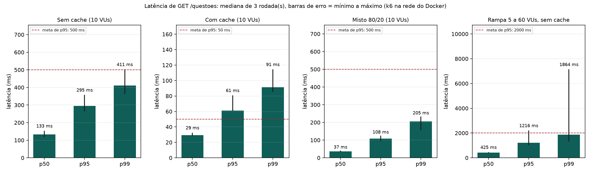

# TP2 Big Data: Plataforma Distribuida de Busca sobre o Acervo do ENADE

Centro Universitario Catolica de Quixada (UniCatolica) - Sistemas de Informacao
Disciplina: Big Data - Prof. Me. Decio Aguiar

## Equipe (Grupo 9)

| Integrante |
|---|
| Arisio Soares Andrade Filho |
| Raul De Queiroz Moura |
| Jose Kayky Barbosa Coelho |
| Levi Marques Waterloo |
| Carlos Neuan Sampaio Silva |

## Visao geral

Pipeline que processa os PDFs de provas do ENADE, estrutura cada questao em um
documento, publica no Kafka, indexa no Elasticsearch e disponibiliza busca por
API REST (com cache Redis) e interface web, com autenticacao via Kerberos e LDAP.

```
[1. Ingestao] -> [2. Kafka] -> [3. Elasticsearch] -> [4. API / Redis] -> [5. Web]
                    Seguranca transversal: Kerberos (servicos) + LDAP (usuarios)
```

## Estrutura do repositorio

```
.
├── docker-compose.yml     # infraestrutura (Kafka, Elastic, Kibana, Redis, ...)
├── .env.example           # modelo de variaveis (copiar para .env)
├── ingestion/             # extracao de PDFs + produtor Kafka
├── consumer/              # consumidor Kafka -> Elasticsearch (+ DLQ)
├── elastic/               # mappings, analisadores, sinonimos
├── api/                   # backend REST (OpenAPI/Swagger)
├── web/                   # cliente web
├── security/
│   ├── kerberos/          # KDC, krb5, keytabs (ignorados no Git)
│   └── ldap/              # arvore LDIF
├── monitoring/            # Prometheus / Grafana
├── bench/                 # testes de carga e resultados
├── scripts/               # utilitarios (topicos, seed, falha induzida)
├── data/
│   ├── raw/               # PDFs (fora do Git)
│   └── samples/           # amostra validada (>= 50 questoes)
└── docs/                  # relatorio SBC e figuras
```

## Pre-requisitos

- Docker Desktop (ou Docker Engine) com Compose v2
- ~6 GB de RAM livres para os containers

## Como executar

```bash
# 1. configurar variaveis
cp .env.example .env        # troque TODAS as senhas "troque-..." (veja abaixo como gerar)

# 2. subir a infraestrutura base
docker compose up -d

# 3. conferir saude dos servicos
docker compose ps
```

Todos os serviços (inclusive OpenLDAP, KDC Kerberos, Prometheus e Grafana) sobem com o mesmo comando; não há perfis opcionais.

Para gerar senhas fortes de uma vez (PowerShell ou bash, com Python instalado):

```bash
python -c "import re,secrets,pathlib; t=pathlib.Path('.env.example').read_text(); pathlib.Path('.env').write_text(re.sub(r'=troque-[a-z-]+', lambda m: '='+secrets.token_urlsafe(18), t))"
```

### Subida do zero

Medido de duas formas, com volumes vazios: `docker compose down -v` seguido de `docker compose up -d --build`
(cerca de 6 minutos até tudo saudável, o Kibana é o último) e, em 21/11, uma **instalação limpa a partir do clone
do GitHub** (sem `.env`, PDFs, cache de OCR nem tessdata; `.env` gerado do `.env.example`). Nela os containers
ficaram de pé em cerca de 3 minutos e o `produtor` republicou `data/processed` sozinho: **6.405 documentos** no
índice em mais ~2 minutos, 35/35 testes da API e o teste do Redis fora do ar (`api/testes/redis_fora.py`)
passando. O `es-setup` espera a licença trial do Elasticsearch ser gerada; o primeiro start do Grafana roda as
migrações do banco interno e leva alguns minutos (o healthcheck foi alargado para isso). Não há passos manuais
além de criar o `.env`.

### Enderecos locais

| Servico | URL / porta |
|---|---|
| Cliente web | http://localhost:8080 |
| API e Swagger | http://localhost:8000/docs |
| Kafka (host) | `localhost:9092` |
| Elasticsearch | http://localhost:9200 |
| Kibana | http://localhost:5601 |
| Redis | `localhost:6379` |
| Redis Insight | http://localhost:5540 |
| Prometheus | http://localhost:9090 |
| Grafana | http://localhost:3001 |

Topicos criados automaticamente: `enade.questoes` e `enade.questoes.dlq`.

Para parar e limpar tudo (inclui volumes): `docker compose down -v`

## Pipeline de ingestão (piloto: Sistemas de Informação)

```bash
pip install -r ingestion/requirements.txt

python ingestion/coleta.py index        # indexa os 1.691 PDFs do INEP em data/manifest.jsonl
python ingestion/extrair.py             # data/raw -> data/processed/{questoes,rejeitadas}.jsonl
python ingestion/produtor.py            # publica no Kafka (enade.questoes / enade.questoes.dlq)
```

- `coleta.py` também baixa PDFs por ano (`download --year 2021`). Os PDFs ficam em `data/raw/` (fora do Git).
- O esquema do documento (1 questão = 1 documento) está em `ingestion/schema/questao.schema.json`.
- O `id` é determinístico (`{ano}-{curso}-{fg|ce}-{q|d}{NN}`) e será o `_id` no Elasticsearch, o que garante idempotência.
- O produtor usa `acks=all`, `enable.idempotence=true` e a chave da mensagem é o `id`.
- Mensagens inválidas ou rejeitadas pelo extrator vão para `enade.questoes.dlq`, com o motivo nos headers.

Resultado do piloto (SI): 2021 gera 40 documentos válidos (35 objetivas + 5 discursivas). Os PDFs de 2014 e 2017
têm a camada de texto corrompida (fonte sem mapeamento Unicode), então o extrator usa OCR (Tesseract, idioma `por`)
nessas páginas, com cache em `data/cache/ocr/`. O OCR é feito por coluna (a calha é achada pelas palavras do OCR),
os títulos "QUESTÃO n" vêm da camada de texto quando legíveis e as alternativas, marcadas por bolinha, são
reconhecidas mesmo com ruído. Resultado: 2014 recupera 32 de 35 objetivas e 2017 recupera 31 de 35 (mais as
discursivas); o restante vai para a DLQ.

Pré-requisito do OCR: instalar o Tesseract (`winget install UB-Mannheim.TesseractOCR`) e baixar
`por.traineddata` (tessdata_best) para `ingestion/tessdata/`.

Observação: o Kafka não elimina duplicatas por chave. Reenviar o mesmo arquivo duplica mensagens no tópico;
a idempotência é garantida no Elasticsearch, usando o `id` como `_id`.

### Acervo processado

Resultado atual da extração (`python ingestion/extrair.py`): **6.405 documentos** de 159 provas, 94 cursos
distintos em 9 áreas, anos 2014, 2017, 2018, 2019, 2021, 2022, 2023 e 2025, e 37 rejeitados (DLQ). Tabela completa em
[docs/volume-acervo.md](docs/volume-acervo.md) (`python ingestion/gerar_volume.py`). Tabelas das provas viram
Markdown (488 questões). Competência, habilidade e objetos são oficiais em 2025 (matriz de prova); na Formação Geral
dos outros anos a competência é inferida por Naive Bayes (`python ingestion/classificacao.py`; 80% de acerto em
leave-one-out com apenas 15 questões de treino, contra 53% da linha de base) e aparece marcada como "inferido".

Os PDFs de 2018 em diante têm texto legível. Os de 2014 e 2017 são escaneados e passam por um **controle de
qualidade**: um PDF com OCR só é indexado se recuperar pelo menos 60% das objetivas do gabarito (2014: 32 de 35,
2017: 31 de 35); as que o OCR não leu vão para a DLQ. Outras particularidades tratadas: marca d'água do INEP nas provas de 2023, questões de 4 alternativas
(Medicina 2023), duas colunas em PDFs com texto, e gabarito conferido contra as alternativas de cada questão.
Baixar as provas: `python ingestion/coleta.py download --lista data/alvo_extracao.json`.
## Consumidor Kafka → Elasticsearch

O serviço `consumer` sobe junto com `docker compose up -d` e indexa `enade.questoes` no alias `enade-questoes`
(índice `enade-questoes-v1`, criado automaticamente a partir de `elastic/mapping.json` e `elastic/sinonimos.txt`).

- **Sem perda:** commit manual do offset só depois do `bulk` bem-sucedido. Se o Elasticsearch cair, o lote é repetido.
- **Idempotência:** `_id` = `id` da questão. Reenviar o mesmo arquivo sobrescreve, não duplica.
- **DLQ:** JSON malformado, fora do esquema ou recusado pelo mapping vai para `enade.questoes.dlq` (motivo no header).
- **Índice:** 3 shards (alinhado às 3 partições do tópico), 0 réplicas (nó único; em cluster usar `ES_REPLICAS=1`).
  Analisador `pt_index` (lowercase, asciifolding, stopwords e stemmer `brazilian`) e `pt_search`, que acrescenta
  sinônimos (`synonym_graph`) só na busca, então o dicionário pode mudar sem reindexar.

Rodar fora do Docker: `python consumer/consumidor.py` (usa `localhost:9092` e `localhost:9200`).

Resultados medidos (piloto, 136 mensagens com 68 duplicadas): 68 documentos no índice, lag final 0.
Falha induzida: com o Elasticsearch parado por cerca de 1 min 20 s e o consumidor ativo, ao religar o índice
recuperou os 68 documentos, sem perda e sem duplicata.

## Cliente web

Abra http://localhost:8080 e entre com uma conta do LDAP (usuário e senha em `.env`; ver `security/ldap/README.md`).
O nginx serve a interface e encaminha `/api/` para a API, então não há CORS. Código em `web/` (HTML, CSS e JavaScript
puros, sem etapa de build).

- **Busca** com texto livre, filtros por área, curso, ano, tipo e componente (com contagens), paginação e o termo
  destacado no próprio texto da questão (inclusive sinônimos).
- **Lista de questões** (carrinho no Redis): adicionar, remover, limpar e exportar em PDF ou JSON.
- **Estudante:** não vê gabarito nem padrão de resposta; ao tentar exportar recebe o aviso de **403**.
- **Professor:** vê gabarito (alternativa correta marcada) e padrão de resposta, exporta a lista e tem a aba
  **Painel** (questões por curso, taxa de acerto do cache e competências por ano).
- Fórmulas (KaTeX) e diagramas (Mermaid) são renderizados quando `midia[].conteudo` vier convertido; hoje as figuras
  aparecem como aviso com a página do PDF de origem, porque a conversão (RF04) ainda não foi feita.
- Tema claro e escuro automáticos; o nginx envia CSP, `X-Frame-Options` e `nosniff`.
## API de busca (FastAPI)

Sobe com `docker compose up -d` em http://localhost:8000. Documentação OpenAPI/Swagger em **/docs**
(botão *Authorize* aceita o login). Código em `api/app/`.

| Rota | Perfil | Descrição |
|---|---|---|
| `POST /auth/token` | todos | login, devolve JWT |
| `GET /questoes` | estudante, professor | busca full-text PT-BR, filtros combináveis (`area`, `curso`, `ano`, `tipo_questao`, `componente`, `competencia`), paginação, highlight (`<mark>`) e facetas |
| `GET /questoes/{id}` | estudante, professor | uma questão (estudante nunca recebe `gabarito` nem `padrao_resposta`) |
| `GET /analise/competencias-por-ano` | professor | histograma por competência ao longo do tempo |
| `GET /analise/distribuicao-por-curso` | professor | contagem por curso, tipo e componente |
| `GET/PUT/DELETE /carrinho…` | estudante, professor | lista de questões da sessão, guardada no Redis (TTL 24 h) |
| `GET /carrinho/exportar?formato=pdf\|json` | professor | exportação para montar simulados |
| `GET /health`, `/health/ready` | público | liveness e prontidão (Elasticsearch e Redis) |
| `GET /metricas/cache`, `POST /cache/invalidar` | professor | hit rate e invalidação manual |

Status HTTP usados: 200, 201, 204, 401 (sem/token inválido), **403** (perfil sem permissão), 404, 409, 422, 503.

**Cache (Redis):** chave `busca:{versao}:{sha1(parâmetros)}`, TTL de 300 s. O consumidor incrementa `cache:versao`
a cada lote indexado, o que invalida as entradas antigas. Se o Redis cair, um disjuntor
(sonda de `PING` a cada 3 s) faz a API continuar sem cache em dezenas de ms; carrinho e métricas respondem 503
(teste: `python api/testes/redis_fora.py`).
O estudante tem chave própria, pois sua busca não alcança `padrao_resposta`.

**Perfis (desenvolvimento):** `AUTH_MODE=dev` usa dois usuários locais (`estudante` e `professor`, senhas no `.env`).
A função `autenticar()` em `api/app/seguranca.py` é o único ponto a trocar pelo bind no LDAP.

Teste de ponta a ponta (32 verificações, incluindo o 403 do estudante, cache, carrinho e exportação):

```bash
python api/testes/smoke_api.py
```

Testes unitários do extrator (44 testes de funções puras: ligaturas, texto ilegível, blocos por questão, números lidos
por OCR, alternativas por letra ou bolinha, texto-base, gabarito em grade, cursos e pareamento, matriz de 2025 e
classificador de competências; sem PDF, rede ou Docker, rodam em menos de 1 s):

```bash
pip install pytest
python -m pytest ingestion/testes -q
```

Medição preliminar: busca sem cache 230 ms e a mesma busca vinda do cache 9 ms (uma amostra, a máquina
estava carregada; os percentis p50/p95/p99 virão do teste de carga).

Observação para Windows: use `127.0.0.1` em vez de `localhost` nos clientes. O `localhost` tenta IPv6 primeiro e
adicionou cerca de 2,7 s a cada requisição. Se o Docker reclamar de `invalid file request` ao construir, marque a
pasta do projeto como "sempre manter neste dispositivo" no OneDrive (`attrib +P -U /S /D`).

## Observabilidade (Prometheus + Grafana)

Sobem com `docker compose up -d`. Grafana em http://localhost:3001 (usuário e senha do `.env`,
`GRAFANA_USER` e `GRAFANA_PASSWORD`); o painel **ENADE - Visão geral** já vem provisionado (pasta ENADE).
Prometheus em http://localhost:9090.

| Fonte | Métricas |
|---|---|
| API (`/metrics`) | latência por rota em histograma (p50/p95/p99), requisições por status, hits e misses do cache |
| Consumidor (`:9100`) | docs/s indexados, DLQ, duração do bulk e **lag do consumidor Kafka** |
| Elasticsearch (exporter) | saúde do cluster, documentos por índice, heap da JVM |
| Redis (exporter) | memória, clientes, hits e misses do keyspace |

O usuário `exporter` do Elasticsearch tem o papel `enade_monitor`: só métricas e metadados de índices,
nenhuma leitura de documentos. Saúde dos serviços também em `GET /health` e `GET /health/ready` da API.

Observação: o Kibana leva alguns minutos para inicializar nesta máquina; o health check já considera isso.
## Medições (RNF01, RNF02, RNF04)

Ambiente: 4 CPUs e 8 GB para o Docker, stack completa na mesma máquina, k6 na rede do Docker.
Reproduzir: `.\bench\rodar_carga.ps1 -Repeticoes 3` e `python bench/resumo_carga.py` (carga da busca);
`python bench/experimentos.py todos` e `python bench/resumo_experimentos.py` (ingestão e falhas).
Os documentos sintéticos dos experimentos têm ids com prefixo `b` e são apagados ao final.

**Latência da busca (GET /questoes), 3 rodadas:**

Rodadas: 3 (cada uma com os 4 cenários). Valores: mediana [mínimo a máximo] em ms.

| Cenário | p50 (ms) | p95 (ms) | p99 (ms) | Meta de referência | Rodadas que atingiram a meta |
|---|---:|---:|---:|---|:--:|
| Sem cache (10 VUs) | 133 [117 a 154] | 295 [263 a 358] | 411 [364 a 503] | p95 < 500 ms | 3 de 3 |
| Com cache (10 VUs) | 29 [28 a 33] | 61 [61 a 81] | 91 [85 a 115] | p95 < 50 ms | 0 de 3 |
| Misto 80/20 (10 VUs) | 37 [34 a 41] | 108 [94 a 125] | 205 [156 a 233] | p95 < 500 ms | 3 de 3 |
| Rampa 5 a 60 VUs, sem cache | 425 [400 a 462] | 1216 [1008 a 2211] | 1864 [1321 a 7146] | p95 < 2000 ms | 2 de 3 |

Vazão média por rodada: 136, 110, 131 req/s. Requisições por rodada: 45170, 36430, 43708. Taxa de erro HTTP: 0.00% (pior rodada).



## Vazão de ingestão (Kafka para Elasticsearch)

| Documentos | Publicação (msg/s) | Até indexar tudo (s) | Vazão ponta a ponta (docs/s) | Bulk p50 (s) | Bulk p95 (s) | Lag máximo | Indexados |
|---:|---:|---:|---:|---:|---:|---:|---:|
| 11150 | 839.8 | 228.1 | 48.9 | 0.37676056338028163 | 0.9277777777777776 | 9950.0 | 11150 |

## Falhas induzidas durante a ingestão

| Falha | Documentos | Indexados na falha | Duração da falha (s) | Recuperação total (s) | Indexados no fim | Perdidos | Reprocessados |
|---|---:|---:|---:|---:|---:|---:|---:|
| Consumidor morto à força (SIGKILL) | 11150 | 2300 | 19.4 | 180.2 | 11150 | **0** | 100 |
| Kafka parado | 11150 | 2300 | 43.8 | 241.0 | 11150 | **0** | - |
| Elasticsearch parado | 11150 | 2300 | 55.2 | 173.5 | 11150 | **0** | - |

Cuidado metodológico: rodadas feitas enquanto outros containers disputavam as mesmas CPUs variaram muito
(p95 sem cache entre 295 e 1.524 ms), então os números acima vêm de rodadas com o ambiente isolado. Mais lições em
[docs/licoes-e-gargalos.md](docs/licoes-e-gargalos.md).
